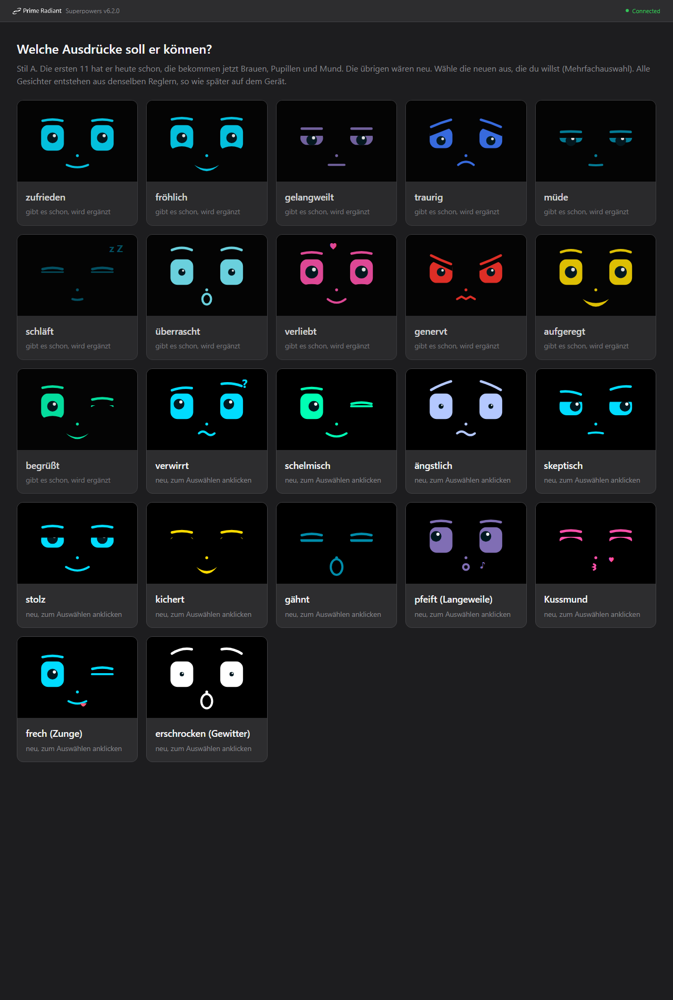
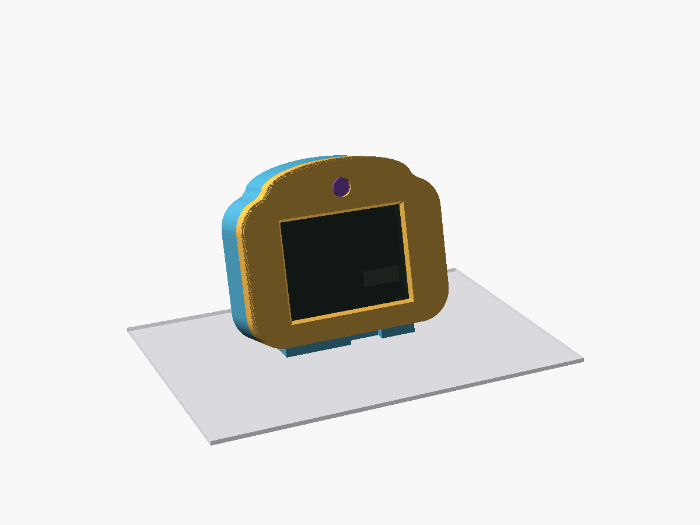
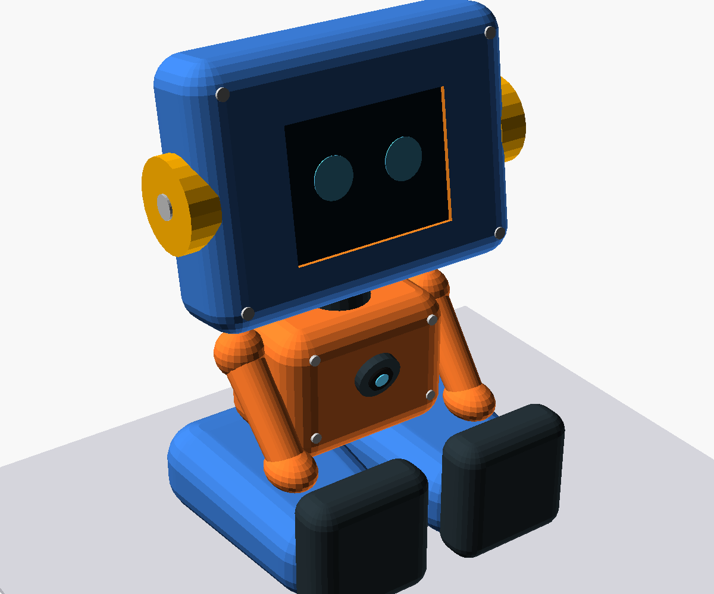

# MadBuddy

MadBuddy ist ein kleines Haustier mit großen Augen auf dem ESP32-2432S028 („Cheap Yellow Display“, CYD). Es schaut sich um, freut sich über Streicheln, langweilt sich, schläft im Dunkeln und reagiert auf Tageszeit und Wetter.

<table>
  <tr>
    <td align="center"> Gesichtsausdrücke</td>
    <td align="center"> Stufe 2: Desktop-Kopf</td>
    <td align="center"> Stufe 3: Roboter (Konzept)</td>
  </tr>
</table>

## Drei Ausbaustufen

| | 1 „Pur“ | 2 „Desktop-Kopf“ | 3 „Roboter“ |
|---|---|---|---|
| Aufbau | nacktes CYD am USB | Gehäuse „Kopf mit Stirn“ (15°-Fuß) | sitzender Roboter |
| Kamera | nein | XIAO ESP32S3 Sense in der Stirn | XIAO in der Brust |
| Strom | USB-Netzteil | USB-C (nur Kabel USB-A auf USB-C) | Akku 2×18650 im Po/in den Beinen, Laden per USB-C im Boden |
| Löten | nein | 4 Drähte | Leitungen, Schalter |
| 3D-Druck | nein | ja (PETG) | ja (PETG) |
| Stand | läuft | Gehäuse druckbar, 2. Testdruck (Fenster) läuft; Kamera-Firmware ist erst geplant (Spec) | Konzept, nur Skizze und Konzeptbilder, keine Druckteile |

## Material

Preise: ca., Stand Oktober 2026, ohne Versand. „Schätzung“ = nicht belegt. Wo kein Link steht, ist ein Suchbegriff angegeben (nicht geprüft).

### Stufe 1 „Pur“

| Menge | Teil | Typ/Bezeichnung | ca. Preis | Bezugsquelle |
|---|---|---|---|---|
| 1 | CYD | ESP32-2432S028, 2,8" mit Touch, **Variante mit 2 USB-Buchsen (Micro-USB + USB-C)** | 15 € | `ESP32-2432S028 2.8 inch USB-C` (AliExpress/eBay); Kaufhinweise: [Projektseite Cheap Yellow Display](https://github.com/witnessmenow/ESP32-Cheap-Yellow-Display) |
| 1 | USB-Kabel | USB-A auf USB-C oder Micro-USB, mit Daten | 3 € (Schätzung) | `USB-A auf USB-C Kabel` |
| 1 | USB-Netzteil | 5 V | 8 € (Schätzung) | `USB Netzteil 5V 1A` |

Summe ca. 25 €.

### Stufe 2 „Desktop-Kopf“ (kommt zu Stufe 1 dazu)

| Menge | Teil | Typ/Bezeichnung | ca. Preis | Bezugsquelle |
|---|---|---|---|---|
| 1 | Kamera-Platine | Seeed XIAO ESP32S3 Sense, **ohne Header** | 14 € (Seeed, 13,99 US-$) bis 24 € (Händler in DE) | [Seeed](https://www.seeedstudio.com/XIAO-ESP32S3-Sense-p-5639.html); [Eckstein](https://eckstein-shop.de/Seeed-Studio-XIAO-ESP32S3-Sense-with-OV2640-Camera-Sensor-EN) (23,95 €) |
| 1 | Kabel/Stecker | 4-polig für P1 und CN1 des CYD; Steckertyp **nicht belegt**. Den Kommentaren nach liegt manchen CYD ein kurzes 4-adriges Kabel mit 1,25-mm-JST-Stecker bei, garantiert ist es nicht. Alternativ direkt auf die Buchsenkontakte löten oder passende Stecker nach Foto bestellen | 3 € (Schätzung) | `JST 1.25 4 Pin Kabel` (nur nach Abgleich mit deinem Board) |
| 4 | Schrauben | M3×8 Zylinderkopf (DIN 912), selbstschneidend in PETG | 3 € (Schätzung) | `M3x8 DIN 912 Schrauben` |
| ca. 100 g | Filament | PETG (Verbrauch geschätzt) | 3 € (Schätzung; Rolle 1 kg ca. 20 €) | `PETG Filament 1,75 mm` |
| 1 | Netzteil | 5 V, ≥ 1 A (die Kamera hängt mit am Kabel) | 8 € (Schätzung) | `USB Netzteil 5V 2A` |
| 1 | Kabel | **USB-A auf USB-C** (Kabel C auf C liefert keinen Strom, siehe unten) | 3 € (Schätzung) | `USB-A auf USB-C Kabel` |

Summe zusätzlich ca. 35–45 €. Netzteil und Kabel aus Stufe 1 lassen sich oft weiterverwenden, wenn das Netzteil mindestens 1 A liefert.

### Stufe 3 „Roboter“ (vorläufig; kommt zu Stufe 2 dazu, Netzteil und Kabel dienen nur noch zum Laden)

| Menge | Teil | Typ/Bezeichnung | ca. Preis | Bezugsquelle |
|---|---|---|---|---|
| 1 | Akkuhalter mit Ladeschaltung | DFRobot DFR0969 „2-Way 18650 Battery Holder“: 2 Zellen, Laden per Micro-USB/USB-C, 5-V-Ausgang 2 A, DIP-Schalter HOLD/NORMAL | 9,90 US-$ | [DFRobot](https://www.dfrobot.com/product-2578.html) |
| 2 | Akkuzellen | 18650 Li-Ion, **Markenzellen** (keine No-Name-Zellen mit Fantasie-Kapazität) | 12 € (Schätzung) | `18650 Akku Samsung Sony Murata` |
| 1 | Schalter | kleiner Schiebeschalter | 2 € (Schätzung) | `Mini Schiebeschalter SPDT` |
| 1 | Litze | dünn, für 5 V/GND | 3 € (Schätzung) | `Litze 0,25 mm²` |
| offen | Schrauben | zusätzliche M3, Anzahl offen | 3 € (Schätzung) | `M3 Schrauben Set` |
| ca. 150 g | Filament | PETG, zusätzlich (geschätzt) | 4 € (Schätzung) | `PETG Filament 1,75 mm` |

Summe zusätzlich ca. 35 € (vorläufig).

### Werkzeug

- Lötkolben (ab Stufe 2)
- 3D-Drucker, der PETG druckt (ab Stufe 2)
- PC mit PlatformIO / VS Code

## Aufbau

### Stufe 1: flashen

1. CYD per USB-Kabel an den PC anschließen.
2. Flashen: `pio run -e cyd2usb -t upload`
3. **Touch einrichten:** Beim ersten Start (oder mit dem Finger auf dem Display beim Einschalten) die vier Pfeile in den Ecken antippen. Die Werte bleiben gespeichert.
4. **WLAN:** Beim ersten Start (und wenn 30 s kein WLAN da ist) öffnet der Buddy den Access-Point **„MadBuddy“**. Mit dem Handy verbinden, WLAN wählen, im Feld **„Ort“** den Wohnort eintragen (z. B. „Berlin“), speichern. Aus dem Ort werden die Koordinaten für das Wetter (Open-Meteo) bestimmt. Der Buddy lebt währenddessen weiter; der Statusstreifen zeigt „WLAN einrichten: MadBuddy“.

### Stufe 2: Desktop-Kopf

Die Kamera erkennt, ob jemand da ist und wo das Gesicht ist. Die Augen sollen dir folgen, der Buddy soll dich begrüßen und einschlafen, wenn du gehst. Am CYD wird kein Kamerabild gezeigt. **Die Kamera-Firmware gibt es noch nicht**, nur die Spec: [`docs/superpowers/specs/2026-10-26-kamera-firmware-design.md`](docs/superpowers/specs/2026-10-26-kamera-firmware-design.md).

**Verkabelung (4 Drähte):**

| CYD | XIAO | Zweck |
|---|---|---|
| P1 VIN (5 V) | 5V | Strom (nicht den 3,3-V-Pin von CN1 nehmen, der Regler reicht nicht) |
| P1 GND | GND | Masse |
| CN1 GPIO 27 (RX2) | D6 / TX | Daten Kamera → CYD |
| CN1 GPIO 22 (TX2) | D7 / RX | Befehle CYD → Kamera |

Beide Boards laufen mit 3,3-V-Logik, ein Pegelwandler ist nicht nötig.

> **Warnung:** Die Pinreihenfolge von P1 und CN1 vor dem Löten am Foto deines Boards prüfen. Sie ist nur aus Spec und Pinout-Seiten bekannt, nicht am Gerät gemessen.

**Reihenfolge:**

1. XIAO **vor dem Einbau** flashen. Sein USB-C ist im Gehäuse nicht erreichbar; spätere Updates laufen per WLAN.
2. Drucken (PETG, 0,2 mm, 3 Wände, ohne Stützen): zuerst `frame_test` (ca. 20 min, prüft Fenster, Glas-Sitz, Lochbild), dann `front`, dann `back`. STL-Dateien unter `case/stl/`.
3. Verdrahten, einbauen, mit 4× M3×8 verschrauben.

**Strom:** USB-C nur mit Kabel **USB-A auf USB-C**. Dem USB-C des CYD fehlen die CC-Widerstände, ein Kabel C auf C liefert keinen Strom. Das Netzteil braucht ca. 1 A, weil die Kamera mitläuft.

Details zu Druck, Maßen und offenen Punkten: [`case/README.md`](case/README.md). Design: [`docs/superpowers/specs/2026-10-26-kamera-gehaeuse-design.md`](docs/superpowers/specs/2026-10-26-kamera-gehaeuse-design.md).

### Stufe 3: Roboter (Konzept)

Sitzende Roboterfigur: Kopf mit CYD, Oberkörper mit der Kamera in der Brust, Akku (DFR0969, 2×18650) in Po und Beinen, Laden per USB-C im Boden. Es gibt nur ein Konzeptmodell (`case/konzept/roboter_konzept.scad`) und Bilder, keine Druckteile. Das Akkumodul liefert 5 V an CYD (P1) und XIAO, ein Schiebeschalter im Boden trennt die Leitung. Laufzeit etwa 7–9 h (Schätzung). Spec: [`docs/superpowers/specs/2026-10-26-roboter-gehaeuse-design.md`](docs/superpowers/specs/2026-10-26-roboter-gehaeuse-design.md).

- Den DIP-Schalter am Akkumodul fest auf **HOLD** stellen, sonst schaltet es bei wenig Last ab.
- **Zum Flashen per Kabel den Schalter auf Aus stellen.** Ob USB-5V und VIN (P1) am CYD gegeneinander geschützt sind, ist noch nicht am Schaltplan geprüft.

## Bedienung

| Geste | Wirkung |
|---|---|
| **Tippen** | kurz überrascht, ein bisschen Unterhaltung |
| **Streicheln** (Finger über das Display ziehen) | verliebt, Herzchen (höchstens alle 2 s) |
| **Stupsen** (5 Tipps in 3 s) | genervt, 20 s rote, böse Augen |
| **High-Five** (Tipp in eine obere Ecke) | Hand in der Ecke, LED blitzt weiß |
| **Finger auflegen / ziehen** | die Augen folgen dem Finger (3 s) |
| **Lang drücken** (> 1,2 s) | Menü |

**Menü** (2×3 Kacheln, schließt nach 10 s ohne Eingabe): Spielen (Fang mich, Simon) · Apfel (Füttern) · Sanduhr (Timer) · Uhr · Zahnrad (Einstellungen) · Zurück.

- **Uhr:** Uhrzeit, Datum, Wetter für 15 s; Antippen schließt.
- **Fang mich:** ein kleines Auge springt herum, 20 s; ab 8 Treffern gewonnen.
- **Simon:** Folge der vier Farbfelder nachtippen; Länge 6 = gewonnen.
- **Füttern:** Apfel, Pizza, Kuchen, Kaffee; oben der Sättigungsbalken. Er hat ein (zufälliges) Lieblingsessen; zu viel macht Bauchweh.
- **Timer (Pomodoro):** 15, 25 oder 45 min Arbeit, dann 5 min Pause. Ein Ring am Rand zeigt den Fortschritt. Pause: LED blinkt 5× grün, Ende: 2× blau.
- **Einstellungen:** Helligkeit (3 Stufen), WLAN/Ort (öffnet das Portal), Firmware (Stand; Tippen sucht ein Update), Info (Version, freier Speicher, Lichtsensor, Charakter-Balken).

**Sprechblasen:** Höchstens alle 90 s sagt er etwas. Morgens begrüßt er dich mit dem Tageswetter, um 20 Uhr zeigt er den **Tagesrückblick** (Tippen schließt), um 22 Uhr gähnt er „Gute Nacht“.

**Hunger, Krankheit, Charakter:** Wird er nicht gefüttert, wird er hungrig. Ist er 2 Stunden lang sehr hungrig und ungeliebt, wird er krank (blass, „Hatschi“). Heilen: satt füttern, dann 3× streicheln. Sterben kann er nicht. Dein Umgang prägt den Charakter: viel Streicheln macht ihn verschmust, Stupsen frech, Spielen verspielt.

**Schlaf:** Nachts (22–7 Uhr) schläft er nach 10 min ohne Berührung ein (Hintergrundlicht 10 %). Ist seine Energie fast leer, macht er ein Nickerchen; eine Berührung weckt ihn.

## Claude-Modus

Mit Claude-Code-Hooks auf dem PC zeigt der Buddy, was Claude gerade tut:

- „Okay!“ beim Auftrag, nachdenklich (orange) beim Denken
- Pupillen huschen beim Lesen, Tipp-Punkte beim Schreiben, drehender Ring bei Befehlen
- „Mist!“ bei Fehlern
- **Blick + gelbe LED „Hey, du!“, wenn Claude dich braucht**
- High-Five „Fertig!“ am Ende

Oranger Funke im Statusstreifen = Sitzung aktiv (daneben die Zahl der Helfer). 15 min ohne Ereignis = wieder Haustier. Der Schlüssel steht unter Einstellungen → Info. Einrichtung: [`tools/claude-hooks/README.md`](tools/claude-hooks/README.md).

## Online-Update

Liegt eine neue Firmware im GitHub-Release, erscheint die Karte „Update bereit“. *Ja* lädt und startet neu, *Später* fragt in einer Stunde wieder. Details: [`docs/ota.md`](docs/ota.md).

## Entwicklung

- Bauen: `pio run -e cyd2usb`
- Flashen (erstes Mal per Kabel): `pio run -e cyd2usb -t upload`
- Tests (am PC): `pio test -e native` (Logik unter `src/logic/`) und `node --test tools/*.test.mjs`
- Sätze: `docs/superpowers/specs/2026-10-25-saetze.json` → `node tools/gen-phrases.mjs` erzeugt `src/logic/phrases.h` (mit committen; `--check` prüft, ob er aktuell ist)
- Veröffentlichen (nur lokal): `pio run -e cyd2usb && node tools/ota-publish.mjs --release`
- Seriell (115200): alle 60 s `heap=… min=… fps=… emo=…`

Aufbau: reine, am PC getestete Logik in `src/logic/*.h` (keine Arduino-Includes, Zeit als Parameter); Hardware in `src/hw/`, Bildschirme in `src/ui/`, Netz in `src/net/` (eigener Task auf Kern 0), Update in `src/ota/`; `src/app.cpp` verbindet alles. Pins und Messwerte (Panel, Touch-Kalibrierung, Lichtsensor) stehen in `src/config.h`.

Design und Pläne: `docs/superpowers/`, Fortschritt: [`docs/FORTSCHRITT.md`](docs/FORTSCHRITT.md), Vorlage für das Online-Update: `reference/ha_buddy_ota/`.
