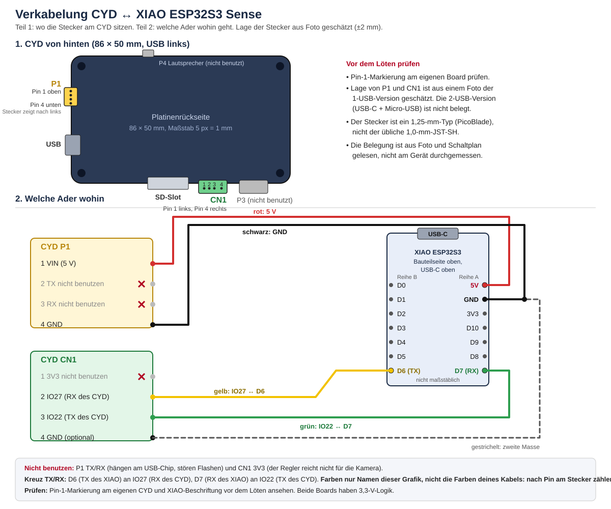

# Verkabelung CYD ↔ XIAO ESP32S3 Sense

Gilt für Stufe 2 (Desktop-Kopf) und Stufe 3 (Roboter). Es werden **4 Adern** verlegt: Strom (5 V, Masse) und zwei Datenleitungen. Die CYD-Seite wird gesteckt, die XIAO-Seite gelötet.



Die Grafik zeigt oben die Lage der Stecker auf der CYD-Rückseite und unten, welche Ader wohin geht. Rot = 5 V, schwarz = Masse, gelb = IO27 ↔ D6, grün = IO22 ↔ D7.

> **Zuerst prüfen:** Die Lage von P1 und CN1 und die Pin-1-Seite sind aus einem Foto (1-USB-Version) und dem Schaltplan gelesen, nicht am Gerät gemessen. **Pin-1-Markierung am eigenen Board prüfen**, bevor du Kabel bestellst oder lötest. Bei der 2-USB-Version (USB-C + Micro-USB) ist die Lage nicht belegt.

## Welche Ader wohin

| CYD-Stecker | Pin | Signal | → XIAO | Pin am XIAO | Farbe in Grafik |
|---|---|---|---|---|---|
| P1 | 1 VIN | 5 V | 5V | Reihe A, Pin 1 (an der USB-Buchse) | 🔴 rot |
| P1 | 4 GND | Masse | GND | Reihe A, Pin 2 | ⚫ schwarz |
| CN1 | 2 IO27 | RX des CYD | D6 (TX) | Reihe B, Pin 7 (gegenüber USB) | 🟡 gelb |
| CN1 | 3 IO22 | TX des CYD | D7 (RX) | Reihe A, Pin 7 (gegenüber USB) | 🟢 grün |

Die Farben sind nur die Namen in dieser Anleitung und der Grafik, **nicht die Aderfarben deines gekauften Kabels**. Maßgeblich ist die Position am Stecker (Pin-Nummer).

⚠️ Die Spalte „→ XIAO“ gilt direkt für Stufe 2. **Im Roboter (Stufe 3)** gehen die Stromadern (P1 Pin 1 und Pin 4) nicht direkt an XIAO 5V/GND, sondern an den Verteilerpunkt (siehe Abschnitt Stufe 3). D6 und D7 gehen in beiden Stufen direkt an den XIAO.

TX und RX sind **gekreuzt**: Der Sender des XIAO (D6) geht an den Empfänger des CYD (IO27), und umgekehrt. Beide Boards laufen mit 3,3-V-Logik, ein Pegelwandler ist nicht nötig.

### Steckertyp und Lage am CYD

| Stecker | Typ | Lage auf der Rückseite | Pin-Zählung | Belegung |
|---|---|---|---|---|
| **P1** | 4-polig, 1,25 mm (PicoBlade, nicht JST-SH 1,0 mm) | linke Schmalseite (USB-Seite), oberhalb der USB-Buchse, Mitte ca. 16 mm von der oberen Längskante, Öffnung nach links | Pin 1 oben (zur oberen Längskante) bis Pin 4 unten (zur USB-Buchse) | 1 VIN, 2 TX, 3 RX, 4 GND |
| **CN1** | 4-polig, 1,25 mm | untere Längskante, ca. 50 bis 61 mm von der USB-Seite, zwischen SD-Slot und P3, Öffnung nach unten | Pin 1 links bis Pin 4 rechts (USB links, Blick auf die Rückseite) | 1 3V3, 2 IO27, 3 IO22, 4 GND |

Die Lagewerte sind aus einem Foto geschätzt (ca. ±2 mm). Die Belegung ist aus Silkscreen und Schaltplan gelesen.

### Der XIAO von oben

Ansicht auf die Bauteilseite, USB-C oben. Die Reihen sind auf der Unterseite gespiegelt. Den Aufdruck am eigenen Board vor dem Löten ansehen.

```
            USB-C
        ┌───────────┐
        │           │
   D0   ●           ●  5V    ← Pin 1 Reihe A, hier die rote Ader
   D1   ●           ●  GND   ← Pin 2, schwarze Ader
   D2   ●           ●  3V3
   D3   ●           ●  D10
   D4   ●           ●  D9
   D5   ●           ●  D8
   D6   ●           ●  D7    ← Pin 7 beider Reihen, gegenüber USB
        └───────────┘
  Reihe B               Reihe A
  (gelbe Ader an D6)    (grüne Ader an D7)
```

Mit Sense-Erweiterung ist der Stapel ca. 15 mm hoch (Seeed-Wiki, Kamera-Anteil unklar). Die Pinlage stammt aus Seeeds Pinout-Zeichnung. Die Spiegelung zwischen Ober- und Unterseite ist mittel sicher, deshalb am Silkscreen prüfen.

## Warnungen

- ⛔ **P1 TX und RX nicht benutzen.** Sie hängen am USB-Seriell-Chip (GPIO 1 und 3). Ein Draht dort stört Flashen und Debug.
- ⛔ **CN1 3V3 nicht benutzen.** Der Regler auf dem CYD reicht für die Kamera nicht. Der XIAO bekommt 5 V und macht seine 3,3 V selbst.
- ⚠️ **Pin 1 am eigenen Board prüfen.** Die Reihenfolge ist aus Foto und Schaltplan gelesen. Im Zweifel die Pinbeschriftung (Silkscreen) am Stecker lesen.
- ⚠️ **XIAO vor dem Einbau flashen.** Sein USB-C ist im Gehäuse nicht erreichbar. Spätere Updates laufen per WLAN.
- ⚠️ **Diode bei gleichzeitigem USB am XIAO.** Der 5V-Pin des XIAO ist ein Ausgang vom USB, laut Seeed-Wiki aber auch als Eingang nutzbar. Hängt dann zusätzlich USB am XIAO, gehört eine Diode (Schottky) dazwischen: Anode zur externen Quelle, Kathode zum 5V-Pin (im Roboter siehe Abschnitt Stufe 3: Diode nur im XIAO-Zweig). Im normalen Betrieb ist der XIAO-USB nicht angesteckt, dann ist keine Diode nötig.
- ⚠️ **Zum Flashen des CYD per Kabel** die Stromzufuhr über P1 trennen (Roboter: Schalter aus). Am CYD hängt USB-5V über eine Diode am selben Netz wie VIN. Laut Schaltplan (Q1 als P-FET am VIN, D1 am USB-5V; aus dem Schaltplanbild gelesen) ist das entkoppelt. **VORLÄUFIG:** nicht am Gerät gemessen, deshalb trotzdem trennen.

## Schritt für Schritt

Material: 2× 1,25 mm 4-Pin Kabel mit Stecker, einseitig offen (je ein Kabel für P1 und CN1), Lötkolben, Multimeter, Schrumpfschlauch oder Isolierband.

1. **Kabel ablängen.** Längen siehe unten (Stufe 2 oder Roboter). Lieber 1 cm zu lang als zu kurz.
2. **Adern isolieren.**
   - Am Kabel mit P1: Pin 1 (VIN) und Pin 4 (GND) abisolieren und verzinnen. Pin 2 und 3 (TX, RX) **kürzen und einzeln mit Schrumpfschlauch isolieren**, sie bleiben unbenutzt.
   - Am Kabel mit CN1: Pin 2 (IO27) und Pin 3 (IO22) abisolieren und verzinnen. Pin 1 (3V3) kürzen und isolieren. Pin 4 (GND) wird **nicht gelötet**, sondern gekürzt und isoliert (die Masse kommt schon über P1 Pin 4; eine zweite Masse ist optional und für den Betrieb nicht nötig). Wer sie trotzdem an XIAO GND löten will, nimmt sie in die Prüfungen von Schritt 5 auf.
   - Die Aderfarben des Kabels sind je nach Hersteller verschieden. **Nach dem Stecker zählen, nicht nach der Farbe**, und die Ader notieren (Klebeband mit Beschriftung).
3. **Spannung messen, bevor am XIAO etwas gelötet wird (live).** ⚠️ Das beantwortet die Frage, ob P1 VIN am CYD überhaupt als **Ausgang** 5 V liefert. Laut Schaltplan ist das nur gelesen, nicht gemessen.
   - Beide Adern TX und RX (P1 Pin 2 und 3) sind einzeln isoliert (Schritt 2), die Enden von Pin 1 und Pin 4 liegen blank, aber nichts berührt sich.
   - Stecker des P1-Kabels in P1 am CYD stecken. Das CYD über **USB** mit Strom versorgen (Kabel USB-A auf USB-C).
   - Multimeter auf Gleichspannung (V=), rote Prüfspitze an die **Pin-1-Ader**, schwarze an die **Pin-4-Ader**, jeweils an den losen Enden. Die Enden dabei nicht kurzschließen.
   - **Soll: +4,5 bis +5,2 V.**
   - **Negativer Wert:** Die Adern sind vertauscht, du hast von der falschen Seite gezählt. Stecker abziehen, Zählung am Stecker prüfen (Pin 1 an der USB-Buchse), nichts löten.
   - **Etwa 0 V oder unter 4,5 V:** P1 VIN funktioniert nicht als Ausgang. Dann trägt die Stufe-2-Stromversorgung über P1 nicht, und es braucht eine andere Lösung. **Stopp, nichts löten**, melde dich damit zurück.
   - Danach USB abziehen, Stecker aus P1 ziehen.
   - Diese Messung betrifft Stufe 2. Im Roboter speist der Akku den Verteilerpunkt, dort ist VIN ein Eingang.
4. **An den XIAO löten.** ⚠️ **Roboter (Stufe 3): Die Stromadern (P1-Pin 1 und Pin 4) NICHT direkt an den XIAO, sondern an den Verteilerpunkt, siehe Abschnitt Stufe 3. Die Signaladern D6/D7 gehen in beiden Stufen direkt an den XIAO.** **In beiden Stufen: XIAO vor dem Löten flashen.** Nach Steckerposition, am Stecker gezählt: Ader von P1-Pin 1 → 5V, P1-Pin 4 → GND, CN1-Pin 2 → D6, CN1-Pin 3 → D7. Kurz löten, nicht zu heiß, die Lötstellen bleiben an der Längsseite des Stapels frei (der Halter lässt dort Platz).
5. **Prüfen mit Multimeter, bevor du einsteckst** (Stecker noch nicht eingesteckt, CYD ohne Strom):
   - Durchgangsprüfung zwischen **5V und GND**, gemessen am **Steckerende**: P1 Pin 1 gegen P1 Pin 4. Es darf **kein** Durchgang sein (kein Kurzschluss). Ein kurzes Piepen beim Anlegen kann von den Kondensatoren kommen, es darf dann aber nicht dauerhaft durchgehen.
   - Falls CN1 Pin 4 (GND) doch gelötet wurde: Steckerende CN1 Pin 4 gegen XIAO GND hat Durchgang, gegen XIAO 5V keinen.
   - Jede Ader gegen ihre Nachbarn prüfen: kein Durchgang.
   - Jede Ader vom Stecker bis zum XIAO-Pin hat Durchgang.
6. **Einstecken.** Stecker bis zum Anschlag in P1 und CN1 drücken. Er passt nur in einer Richtung, nicht mit Gewalt. Dann erst Strom anschließen.

## Stufe 2: Desktop-Kopf

Der XIAO-Stapel liegt in der Wiege hinter der Kamera in der Stirn, `xiao_offset` [7, 0] mm. Die Kabelwege zu P1 (linke Schmalseite) und CN1 (untere Längskante) sind im CAD auf freie Bahn geprüft (`cable_dummy` in `case/madbuddy_case.scad`).

| Kabel | Weg im CAD (Luftlinie der Stücke, Mittelwerte) | Empfehlung |
|---|---|---|
| zu CN1 | ca. 65 mm (vom Stapel quer über die Platine zum Stecker an der unteren Kante) | **ca. 80 mm** |
| zu P1 | ca. 50 mm (schräg über die Platine, dann an der Schmalseite hoch) | **ca. 80 mm** |

- **VORLÄUFIG:** Die Wege sind aus den geschätzten Steckerlagen (±2 mm) und einem groben Linienzug gerechnet, dazu kommen ca. 10 mm zum Abisolieren und Löten. Beide Kabel in einer Länge zu kaufen (80 bis 100 mm) ist einfacher. Am eigenen Aufbau mit einem Faden vorher abmessen.
- Der Weg liegt hinter den Rückseitenbauteilen. Die Kabel nicht über die SD-Karte oder die USB-Buchse legen.
- Strom kommt vom USB-Netzteil am CYD. Der XIAO hängt über die rote Ader an P1 VIN mit am Netzteil (mind. 1 A).
- **VORLÄUFIG:** Dass P1 VIN am CYD als **Ausgang** 5 V für den XIAO liefert, ist **unbewiesen**, bis die Messung in Schritt 3 bestanden ist. Es widerspricht außerdem der Begründung in den Warnungen (Q1/D1 entkoppeln VIN und USB-5V): Wenn Q1 VIN vom USB-Netz trennt, steht an VIN eventuell keine Spannung. Die Messung entscheidet.

## Stufe 3: Roboter

Der XIAO liegt in der Brust (Kamera 15° nach oben gekippt), das CYD im Kopf. Die Kabel laufen durch den Hals (Rohr Ø 22) in den Kopf. Reihenfolge beim Einbau steht in `case/README.md`: Kamera einsetzen, Riegel von +X einschieben, XIAO-Stapel von hinten einlegen, dann `torso_back` schließen.

- **Kabellänge ca. 150 mm** für beide Kabel (durch den Hals, Spec). **VORLÄUFIG:** Der Wert stammt aus der Spec, nicht aus einer Messung am Modell. Am eigenen Aufbau von der Brust bis zu P1 und CN1 mit einem Faden abmessen, dazu ca. 10 mm Reserve.
- **Strom:** Akku (DFR0969) → Schiebeschalter → 5 V und GND.
  - **Verteilerpunkt hinter dem Schalter** (Lötverbinder oder Quetschhülse), zwei Zweige:
    - **Zweig 1:** Ader von P1 Pin 1 (VIN) direkt an den Verteilerpunkt 5 V, die Ader von P1 Pin 4 (GND) an den GND-Verteiler. Sie hängt **vor** der Diode, der Strom des CYD fließt nicht durch die Diode.
    - **Zweig 2:** Verteilerpunkt 5 V → **Diode** (Schottky, Anode zum Verteilerpunkt, Kathode zum XIAO-5V-Pad) → XIAO 5V. GND vom Verteiler an XIAO GND.
  - Die Diode gehört **nur in den XIAO-Zweig**. Sie schützt vor Rückspeisung, falls doch einmal USB am XIAO hängt. Der XIAO-5V-Pin ist laut Recherche als Eingang zulässig.
  - **VORLÄUFIG:** Die dünne P1-Ader (1,25-mm-Kabel) trägt dann die ganze Last des CYD. Die Strombelastbarkeit von P1 VIN ist nicht belegt, am eigenen Aufbau prüfen (Wärme der Ader und des Steckers beim Betrieb).
  - Zuleitung vom Akku bis zum Verteiler: Litze mind. 0,25 mm², weil CYD und Kamera zusammen bis etwa 1 A ziehen können (Schätzung).
  - Der DIP-Schalter am Akkumodul steht fest auf **HOLD**.
  - **VORLÄUFIG:** Die Lage von Schalter und Anschlusspads am Akkumodul ist aus dem Datenblatt geschätzt. Auf dem eigenen Modul prüfen, welche Pads 5 V und GND sind.
- **Flashen des CYD per Kabel:** Schalter aus (siehe Warnungen).
- Beim Schließen von `torso_back` die Adern nicht einklemmen. Die Adern liegen vorher an der Seite des Stapels, wo die Wiege Platz lässt.

## Was noch offen ist

- Die Lage von P1 und CN1 am eigenen Board und bei der 2-USB-Version.
- Die Kabellängen beider Aufbauten (VORLÄUFIG, siehe oben).
- **Stufe 2: Versorgung des XIAO über P1 VIN (VIN als Ausgang) ist unbewiesen.** Sie gilt erst nach bestandener Spannungsmessung (Schritt 3, +4,5 bis +5,2 V). Fällt die Messung durch, braucht Stufe 2 eine andere Stromlösung.
- Die Strombelastbarkeit von P1 VIN ist nicht belegt. Für CYD plus Kamera mit ca. 1 A rechnen und am eigenen Aufbau testen.
